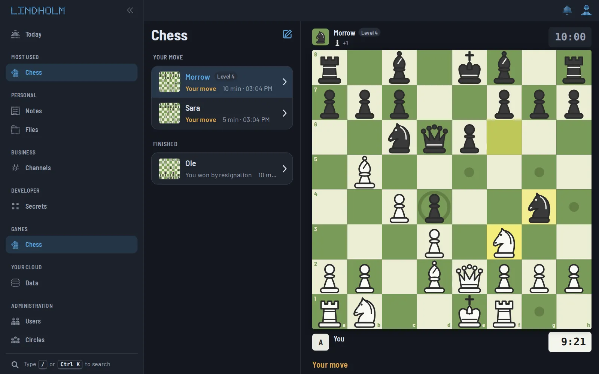
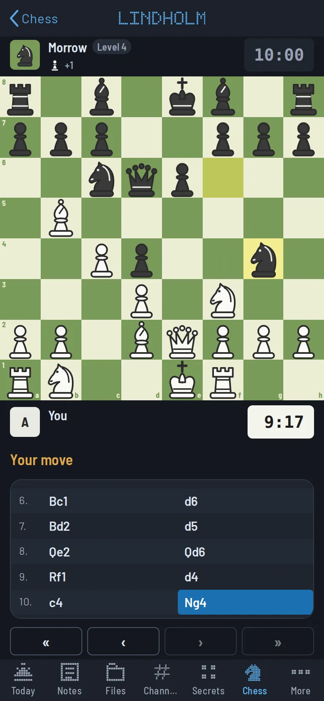
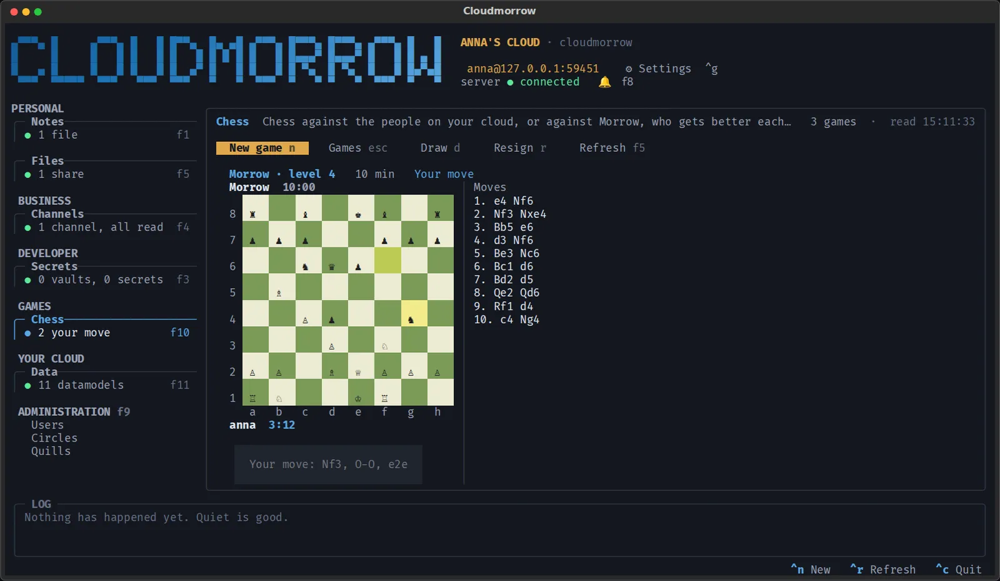

# Chess

Chess against the people on your cloud, or against Morrow, who gets better
each time you beat him — with no limit, ten minutes or five minutes each on
the clock.

A [Quill](https://github.com/Cloudmorrow/cloudmorrow/blob/main/docs/QUILLS.md)
for Cloudmorrow: install it from the Quill Catalog, or from this repository
with `cm quill add --source https://github.com/Cloudmorrow/quill-chess --ref v1.0.0`.
It needs a Cloudmorrow server with the chess kit (the release after v0.108.0).

<p>


</p>


(A throwaway cloud made for the pictures, named after nobody real.)

- **Play anybody on your cloud.** The pen is a new game: pick who — any
  person on the server, or Morrow — how long, and which colour. A game
  against a person is on their list at once, with a push to tell them.
- **Or play Morrow.** He starts at level 1, where he looks one move ahead
  and leaves pieces hanging, and goes up a level each time you beat him,
  to level 10, where he looks five moves ahead and gives nothing away.
  Losing or drawing leaves him where he is. Every person has their own
  Morrow, at their own level.
- **A chess clock.** No limit, 10 minutes or 5 minutes each. The clocks
  start once both sides have moved, run on every screen the game is open
  on, and the side whose time runs out loses — unless the other has
  nothing left to mate with, when it is a draw.
- **A board you know.** Flat, green and cream, seen from above, white at
  the bottom unless you play black. Press a piece and where it may go is
  dotted; press there, or drag it. The last move is lit, a king in check
  glows, a pawn at the end asks what it becomes, and what each side has
  taken is drawn beside its name.
- **The rules, all of them.** Every move is checked before it is kept:
  castling, taking in passing, promotion, check and mate, stalemate, a
  position three times over, the fifty-move rule, and too little left to
  mate with.
- **Resign, a draw, a rematch.** Offer a draw and the other side can take
  it or turn it down; Morrow takes one only when he stands worse. Once it
  is over, Rematch plays the same person again with the colours swapped.

## Using it

#### In the web app

The **Chess** tab: your games, those where it is your move first, then the
ones waiting on the other player, then the finished ones, each with a
small picture of its board. On a computer the open game is beside the
list: the board in the middle, the other player and their clock above it,
you and yours below, the moves and the buttons on the right. On a phone,
the game is a page of its own, the board from edge to edge. The arrows
under the moves look back through the game; any press on the board brings
you back to now.

#### In the terminal app

The **Chess** card: the games, then one game's board in text with the
clocks and the moves beside it. Type a move — `e4`, `Nf3`, `O-O`, `e8=Q` —
and Enter. `n` starts a new game, `d` offers or takes a draw, `r` resigns.

#### On the command line

```
cm chess list                         # your games, and where each stands
cm chess new Morrow --clock 10m --colour white
cm chess new sara --clock 5m          # a person, by their username
cm chess show <game>                  # the board, the clocks, the moves
cm chess move <game> Nf3              # or g1f3
cm chess draw <game>                  # offer one, or take the one offered
cm chess resign <game>
```

A game is named by the start of its id, as `list` prints it, or its name.

## How it works

A game between two people is kept at their **table**: a space shared by
exactly the two of them, found from either side, so nobody else on the
server sees their games. Games against Morrow are at your own table, which
is yours alone. A game keeps the moves played, what each side had left on
the clock after its last move, and since when the side to move has been
thinking; the board, the clocks and the moves are worked out from those on
every screen by the core's chess kit.

Every move goes through the Quill's code, which checks it by the rules
(the core's `cloudmorrow.quill.chess`), takes the time spent off the
mover's clock, notices the end of the game, and, against Morrow, has him
answer. **Morrow** (`morrow.py`) looks ahead with alpha-beta search,
follows captures to the end, and weighs what he sees by the pieces and
where they stand; his level sets how far he looks and how loosely he
plays. He runs in the sandbox, so how long he thinks is counted in
positions looked at, never more than a second or two.

## What it adds to your Cloudmorrow

`cm quill check` prints this for you; it is here for the catalog page.

| | |
| --- | --- |
| Datamodels | introduces `chess.table` (a space: the two people a game is between, or your own against Morrow), `chess.game` and `chess.computer` (Morrow, and his level against you) |
| Screens | Chess, a chess board, on the phone, the web app, the terminal, `cm chess`, and to your assistant |
| Actions | New game; Play (a move, resign, a draw, a fallen flag) |
| Code | `quill.py` and `morrow.py`, in the sandbox, as whoever uses it; reaches nothing outside |

## Working on it

```
uv sync                  # .venv with Cloudmorrow and pytest
cm quill check           # the manifest, as a server would install it
cm quill test            # tests/, against the real record store and gate
cm quill test --sandbox  # the same, with quill.py in the sandbox
cm quill dev --local     # a throwaway server here, reinstalled as you save
```

The pictures in `screenshots/` (`<screen>-desktop.webp` 1600×1000,
`<screen>-phone.webp` 780×1688, `<screen>-tui.webp` 1600×930, captioned in
quill.toml's `[[screenshots]]`) are taken from a throwaway cloud named
after nobody real, never from anybody's own cloud. Retake them when the
screen changes.
